<p align="center">
  <picture>
    <source media="(prefers-reduced-motion: reduce)" srcset="assets/readme/hero-static.svg">
    
  </picture>
</p>

<p align="center">
  <a href="https://github.com/rifqifitriady/ZAAFElegia/actions/workflows/ci.yml"></a>
  <a href="https://github.com/rifqifitriady/ZAAFElegia/releases"></a>
  <a href="LICENSE"></a>
  
  
</p>

<p align="center">
  <b>ZAAFElegia runs <a href="https://github.com/SigmaHQ/sigma">Sigma</a> rules directly over your logs.</b><br>
  No translation into another query language: the rule you read is the rule that runs. Written in Rust.
</p>

<p align="center">
  <a href="#quick-start">Quick start</a> ·
  <a href="#how-it-works">How it works</a> ·
  <a href="#proof-not-promises">Proof</a> ·
  <a href="#roadmap">Roadmap</a> ·
  <a href="conformance/README.md">Conformance suite</a>
</p>

> [!NOTE]
> **0.0.1 pre-release (milestone M1).** Single-event rules over JSON and NDJSON.
> Correlation rules, EVTX and cloud logs, Parquet and the AI-attack rule pack are planned,
> not yet available. See the [roadmap](#roadmap) and the [design spec](docs/superpowers/specs/2026-11-07-zaafelegia-v0.1-design.md).

## How it works

<p align="center">
  <picture>
    <source media="(prefers-reduced-motion: reduce)" srcset="assets/readme/how-it-works-static.svg">
    
  </picture>
</p>

1. **Rule.** Sigma 2.1 YAML is parsed with positions, so every problem is reported as `file:line:col`.
2. **Compile.** Each rule becomes a boolean expression with every modifier already resolved (`windash`, `base64offset`, `cidr`, `re`, placeholders and the rest). Field names are mapped by optional pipelines.
3. **Match.** The native evaluator checks each event against the compiled rules. It is the semantic reference that later evaluators will be tested against.
4. **Emit.** Every match becomes an [OCSF](https://schema.ocsf.io/) Detection Finding that carries the rule's author and references.

## Quick start

You need Rust 1.89 or newer (the minimum supported version). Install it with [rustup](https://rustup.rs/).

```bash
git clone https://github.com/rifqifitriady/ZAAFElegia
cd ZAAFElegia
cargo install --locked --path crates/zaaf-cli
```

```bash
# Lint rules (exit 2 on errors)
zaaf check path/to/sigma/rules

# Hunt over NDJSON: a table on a terminal, OCSF NDJSON when piped
zaaf hunt -r path/to/sigma/rules logs/*.ndjson

# Read from stdin and fail a CI job on any match
cat today.ndjson | zaaf hunt -r rules/ -o ndjson --fail-on-match -
```

Table and json output appear at the end of the input; ndjson and csv stream as events arrive.

`zaaf check` reports each diagnostic as `file:line:col: path: message` (prefixed with its
severity, `error:` or `warning:`), where `path` is the location inside the rule's YAML.

Sigma rules use Windows/Sysmon field names (`Image`, `CommandLine`). If your logs
use other names, map them with a pipeline:

```yaml
# ecs-windows.yml
name: ecs-windows
transformations:
  - type: field_name_mapping
    mapping:
      Image: process.executable
      CommandLine: process.command_line
    rule_conditions:
      - product: windows
```

```bash
zaaf hunt -r rules/ -p ecs-windows.yml logs.ndjson
```

## What a finding looks like

An excerpt of real `zaaf hunt -o ndjson` output for a rule that matches an encoded PowerShell command line
(the full finding also has `metadata`, `status` and the complete `unmapped.sigma` block):

```json
{
  "class_uid": 2004,
  "class_name": "Detection Finding",
  "type_uid": 200401,
  "severity": "High",
  "time": 1794107646000,
  "finding_info": {
    "title": "Encoded PowerShell command line",
    "types": ["attack.execution", "attack.t1059.001"],
    "analytic": { "uid": "5f1c2a3e-6b8d-4c1e-9a7f-2d3b4c5e6f70", "type": "Rule" }
  },
  "evidences": [{ "data": {
    "EventID": 4688,
    "Image": "C:\\Windows\\System32\\WindowsPowerShell\\v1.0\\powershell.exe",
    "CommandLine": "powershell.exe -nop -w hidden -enc SQBFAFgA"
  }}],
  "unmapped": { "sigma": {
    "author": "ZAAFElegia example",
    "references": ["https://attack.mitre.org/techniques/T1059/001/"]
  }}
}
```

## Proof, not promises

Three things you can check yourself:

| Claim | Where to verify |
|---|---|
| **3,807 of 3,807** SigmaHQ rule files parse and compile, with no warnings | [`scripts/sigmahq-corpus.sh`](scripts/sigmahq-corpus.sh) runs in CI against SigmaHQ commit `53b90df`, using the placeholder pipeline [`tests/sigmahq/placeholders.yml`](tests/sigmahq/placeholders.yml). This measures parse and compile only, not detection accuracy. |
| **30-case** language-neutral Sigma 2.1 conformance suite, with every interpretation written down | [`conformance/`](conformance/README.md). Any engine can run it. |
| **Fuzzed** rule parser, input reader and evaluator | [`fuzz/`](fuzz/) runs on every pull request and nightly ([workflow](.github/workflows/fuzz.yml)). |

Every dependency must pass a `cargo-deny` licence policy that rejects copyleft licences.

## Roadmap

<p align="center">
  <picture>
    <source media="(prefers-reduced-motion: reduce)" srcset="assets/readme/roadmap-static.svg">
    
  </picture>
</p>

| Milestone | Scope | Status |
|---|---|---|
| **M1 · Engine core** | Sigma 2.1 parser, compiler and native evaluator; `zaaf check` and `zaaf hunt`; OCSF output; conformance suite; SigmaHQ corpus in CI; fuzzing | Shipped in [v0.0.1](https://github.com/rifqifitriady/ZAAFElegia/releases/tag/v0.0.1) |
| **M2 · Correlation** | Sigma v2 correlation rules (`event_count`, `value_count`, `temporal`, `temporal_ordered`, value aggregations) with an ordering buffer and watermark | Next |
| **M3 · Real log sources** | Windows EVTX; CloudTrail (including Bedrock), Entra ID, Okta, M365 and GitHub audit presets; Sysmon, ECS and OCSF pipelines; SigmaHQ `regression_data` | Planned |
| **M4 · Fast history** | The same rules over Parquet through Apache DataFusion, `zaaf explain`, differential tests against the native evaluator | Planned |
| **M5 · AI-era detection** | `zaaf test` and `zaaf coverage` (ATT&CK and ATLAS); a rule pack for LLM gateways and MCP tool calls; a GitHub Action | Planned |
| **v0.1 · Public release** | Prebuilt binaries for Linux, macOS and Windows; a documentation site; open benchmarks | Planned |

## Reference

<details>
<summary><b>Output formats</b></summary>

Each match is an [OCSF](https://schema.ocsf.io/) Detection Finding (class 2004).
That is the `json` and `ndjson` output (`-o json|ndjson`). The rule's `author` and
`references` are always included under `unmapped.sigma`, as the Detection Rule License
(DRL 1.1) requires for SigmaHQ rules.

`-o csv` and `-o table` are summaries, not OCSF. CSV has the columns
`time,level,rule_id,title,author,references,source` (references joined with ` | `).
The table shows the author but not the references, which are too long for it; use
`-o json`, `ndjson` or `csv` to see them.

</details>

<details>
<summary><b>Exit codes</b></summary>

| Code | Meaning |
|---|---|
| 0 | Success |
| 1 | Matches found (only with `--fail-on-match`) |
| 2 | Usage errors. `zaaf check` exits 2 on any rule error; `zaaf hunt` exits 2 on rule errors only with `--strict`, and also when no rules are left to run |
| 3 | Input errors: an unreadable input always (missing file, a directory, or a read error); malformed records (including oversized lines) only with `--strict` or above `--max-errors` |
| 4 | Internal error |

When several conditions hold, the highest-precedence code wins (4 > 3 > 2 > 1 > 0).
A broken output pipe (for example `zaaf hunt ... | head`) exits 0.

</details>

<details>
<summary><b>Input</b></summary>

`zaaf hunt` reads NDJSON, a JSON array, or stdin. NDJSON lines over 8 MiB and JSON arrays
over 256 MiB are reported as input errors. An oversized NDJSON line counts as a malformed
record, so it exits 3 only with `--strict` or above `--max-errors`. JSON arrays are buffered in memory in full, so
prefer NDJSON for large inputs.

`--from` and `--to` take RFC 3339 timestamps only (for example `2026-11-07T01:00:00Z`); anything
else, such as a bare year, is a usage error. Events without a detectable timestamp pass the
`--from`/`--to` filter, and their finding's `time` is the processing time.

</details>

<details>
<summary><b>Limits</b></summary>

To keep rules from exhausting memory or time, ZAAFElegia enforces these limits:

- Condition nesting depth: at most 64.
- Value expansion (for example a modifier chain over a list): at most 4,096 variants.
- Predicates per detection item: at most 16,384.
- Per rule: at most 65,536 weight units (a regular expression counts as 16, 256, 1,024 or 4,096).
- Per run: at most 1,000,000 weight units across all loaded rules.
- Regular expressions are weighed by compiled size (program plus lazy-DFA cache). The smallest
  tier a pattern fits decides its weight: up to 16 KiB is 16 units, 256 KiB is 256, 1 MiB is
  1,024 and 4 MiB is 4,096, so one unit is about 1 KiB. A pattern above 4 MiB is a rule error
  naming the limit. With the budgets above, compiled regexes use at most about 64 MiB per
  rule and about 1 GiB per run. Match-time lazy-DFA caches can grow by up to the same
  amount again, so the worst case is about 2 GiB.
- Regular expressions use a linear-time engine. Patterns it cannot run fall back to a
  backtracking engine capped at 1,000,000 steps. Hitting that cap counts as no match, and
  `zaaf hunt` prints a warning naming the rule.
- `fieldref|contains` (and the other `fieldref` modes) compares every pair of values of the
  two fields, so its cost grows with the square of the array sizes in the referenced fields.
  Each event is bounded by the 8 MiB line cap; a per-event work budget is planned.

</details>

## Contributing

See [CONTRIBUTING.md](CONTRIBUTING.md). Security issues: [SECURITY.md](SECURITY.md).
Please follow the [Code of Conduct](CODE_OF_CONDUCT.md).

The README artwork is generated by [`assets/readme/src/build.py`](assets/readme/src/build.py).

## License

Apache-2.0. See [LICENSE](LICENSE) and [NOTICE](NOTICE). ZAAFElegia does not bundle
the SigmaHQ rules; they are licensed separately under DRL 1.1.

The README artwork embeds subsets of Big Shoulders Display and IBM Plex Mono, both under the
SIL Open Font License 1.1 ([licence texts](assets/readme/fonts/)).
